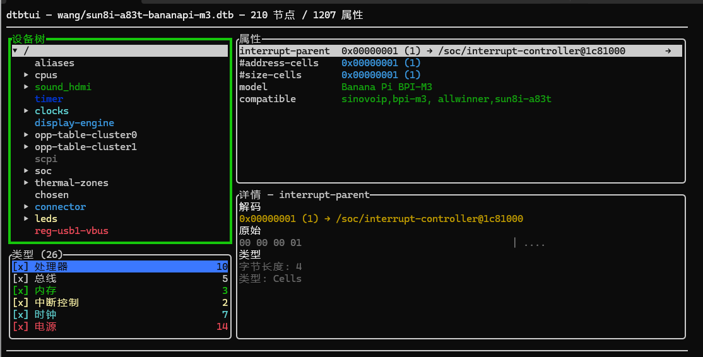

# dtbtui

终端里的设备树（DTB）查看器。用键盘和鼠标浏览 `.dtb`。

```bash
dtbtui /boot/dtb/allwinner/sun60i-a733-orangepi-4-pro.dtb
```



界面布局见下文「界面」一节。

## 功能

- 树浏览：折叠/展开、光标移动、翻页、滚动。
- 属性面板：按原顺序列出节点的属性，值按类型着色。
- 属性详情：分三段显示解码值、原始字节、类型与长度。
- 类型面板：把设备归入 30 个类型，按类型筛选树，同类型同颜色。
- 名字搜索：`/` 增量过滤，匹配节点名与属性名。
- phandle 跳转：`interrupt-parent` 一类属性按 `Enter` 跳到目标节点，`Backspace` 退回。
- 帮助浮层：`?` 列出全部键位。
- 鼠标：点行选中、点三角折叠、滚轮滚动。
- `--dump`：不启动 TUI，把整棵树打印成纯文本。

## 依赖

- Linux。加载层用 `libfdt`。
- C++20 。
- xmake v3.1.2。

`xmake.lua` 里的第三方包由 xmake 自动拉取：`ftxui`、`fmt 12.2.1`、`argparse v3.2`、`doctest v2.5.3`、`libfdt`。

## 构建

```bash
xmake b                          # 调试构建
xmake f -m release && xmake b    # 发布构建
```

产物在 `build/<os>/<arch>/<mode>/dtbtui`。本机为 `build/linux/arm64/debug/dtbtui`。

### 静态构建（可分发）

`--static-build=y` 搭配 musl 工具链, 产出不依赖运行库的单个 elf：

```bash
xmake f --static-build=y --toolchain=cross \
        --sdk=~/ssd/usr/opt/aarch64-linux-musl-native
xmake b
file build/linux/arm64/release/dtbtui
# ... ELF 64-bit LSB executable, ARM aarch64, ... statically linked, stripped
```

把 `build/<os>/<arch>/<mode>/dtbtui` 拷到同架构目标机即可运行。

## 用法

```bash
# 打开 dtb 文件
dtbtui /boot/dtb/allwinner/sun60i-a733-orangepi-4-pro.dtb

# 打开运行中的设备树
sudo dtbtui /sys/firmware/fdt

# 从标准输入读
cat some.dtb | dtbtui -

# 纯文本输出，不开 TUI
dtbtui --dump some.dtb

# 用 xmake 直接跑，参数跟在后面
xmake r dtbtui --dump some.dtb
```

`/sys/firmware/fdt` 只有 root 可读。普通用户打开它会失败。

### 退出码

| 情况 | 退出码 |
| --- | --- |
| 正常退出 | 0 |
| 参数错误、文件打不开、stdin 读取失败 | 2 |
| 空文件，或 `fdt_check_full` 校验失败 | 1 |

dtb 校验失败时启动全屏错误页。页面显示路径与 `fdt_strerror` 文本，按 `q` 退出。本工具不做截断容错，不显示半棵树。

## 界面

```text
dtbtui — /boot/dtb/allwinner/sun60i-a733-orangepi-4-pro.dtb — 877 节点 / 7485 属性
────────────────────────────────────────────────────────────────────────────────────────────────────
╭设备树──────────────────────────╮┏属性━━━━━━━━━━━━━━━━━━━━━━━━━━━━━━━━━━━━━━━━━━━━━━━━━━━━━━━━━━━━┓
│▾ /                             │┃compatible           allwinner,uart-v100                        ┃
│  ▸ soc@3000000                 │┃reg                  0x0000000002500000  0x400  (1024 B)        ┃
│      uart@2500000              │┃interrupts           0x00000000 (0)  0x00000002 (2)  0x00000004…┃
│      uart@2501000              │┃sunxi,uart-fifosize  0x00000040 (64)                            ┃
│      uart@2502000              │┃clocks               0x00000012 (18)  0x0000009a (154)          ┃
│      uart@2503000              │┃resets               0x00000012 (18)  0x00000029 (41)           ┃
│      uart@2504000              │┃uart0_port           0x00000000 (0)                             ┃
│      uart@2505000              │┃uart0_type           0x00000002 (2)                             ┃
│      uart@2506000              │┃status               okay                                       ┃
│      uart@7080000              │┃pinctrl-names        default, sleep                             ┃
│      uart@7081000              │┃pinctrl-0            0x00000034 (52)                            ┃
│                                │┃pinctrl-1            0x00000035 (53)                            ┃
│                                │┃phandle              0x0000019e (414) → /soc@3000000/uart@2… →  ┃
│                                │┗━━━━━━━━━━━━━━━━━━━━━━━━━━━━━━━━━━━━━━━━━━━━━━━━━━━━━━━━━━━━━━━━┛
│                                │╭详情 — reg──────────────────────────────────────────────────────╮
│                                ││解码                                                            │
│                                ││0x0000000002500000  0x400  (1024 B)                             │
│                                ││原始                                                            │
╰────────────────────────────────╯│00 00 00 00 02 50 00 00 00 00 00 00 00 00 04 00 | .....P.......…│
╭类型 (30)───────────────────────╮│类型                                                            │
│[x] 中断控制                   3││字节长度: 16                                                    │
│[x] IOMMU                      3││类型: Reg                                                       │
│[x] 时钟                      12││                                                                │
│[x] 电源                      53││                                                                │
│[x] 管脚                       2││                                                                │
│[x] 存储                       7││                                                                │
│[*] 串口                       9││                                                                │
│[x] I2C                       16││                                                                │
╰────────────────────────────────╯╰────────────────────────────────────────────────────────────────╯
────────────────────────────────────────────────────────────────────────────────────────────────────
焦点: 属性 | /soc@3000000/uart@2500000 | 类型: 单独 串口
```

上图是 `sun60i-a733-orangepi-4-pro.dtb` 的实拍：类型面板单独显示「串口」，属性焦点在 `uart@2500000` 的 `reg` 上。

- 左列上方是「设备树」，下方是「类型」。右列上方是「属性」，下方是「详情」。
- 状态行显示焦点、当前节点路径、搜索串、类型筛选状态、跳转栈深度。
- 节点名按设备类型着色，与类型面板的同一行同色。`status = "disabled"` 的节点置灰。
- 宽度不足时行尾截断为 `…`。

## 键位

`?` 打开帮助浮层。`Esc` 或 `?` 关闭。

### 全局

| 键 | 作用 |
| --- | --- |
| `q` / `Ctrl-C` | 退出。帮助或搜索打开时先关闭浮层 |
| `?` | 帮助浮层开/关 |
| `/` | 打开搜索输入行，增量过滤 |
| `Esc` | 清空搜索，再按取消单独显示，最后关闭帮助 |
| `Tab` / `Shift-Tab` | 焦点循环：设备树 → 类型 → 属性 |
| 滚轮 | 滚动 3 行，作用于指针所在面板 |

### 设备树

| 键 | 作用 |
| --- | --- |
| `j` / `↓`、`k` / `↑` | 光标下移、上移 |
| `l` / `→` | 展开当前节点一层 |
| `h` / `←` | 折叠当前节点。已折叠时跳到父节点 |
| `Space` | 切换折叠 |
| `Enter` | 焦点移到属性面板 |
| `g` / `G` | 首行、末行 |
| `Ctrl-D` / `Ctrl-U`、`PgDn` / `PgUp` | 翻页 |
| 左键点行 | 选中该行 |
| 左键点 `▸`/`▾` | 只切换折叠，不移动光标 |

### 类型

| 键 | 作用 |
| --- | --- |
| `j` / `k`、`g` / `G` | 移动光标、跳首尾 |
| `Space` | 启用/关闭该类型 |
| `Enter` | 单独显示该类型 / 取消单独显示 |
| `Esc` | 取消单独显示 |
| 左键点 `[x]` | 只切换开关，不移动光标 |
| 左键点行 | 选中该行 |

### 属性

| 键 | 作用 |
| --- | --- |
| `j` / `↓`、`k` / `↑` | 光标下移、上移 |
| `Enter` | 跳到可解析 phandle 的目标节点 |
| `h` / `←` | 焦点移到设备树面板 |
| `Backspace` | 沿跳转栈退回上一个节点 |
| `g` / `G` | 首个、最后一个属性 |
| `Ctrl-D` / `Ctrl-U`、`PgDn` / `PgUp` | 翻页 |

带 `→` 标记的属性可以跳转。目标节点不存在时，状态行提示 `phandle 0x… 未解析`，视图停在原地。

### 搜索输入行

输入字符即过滤。`Backspace` 删字符。`Enter` 确认过滤并关闭输入行。`Esc` 清空过滤，并恢复过滤前的折叠状态、光标和滚动位置。

## 类型面板

设备树没有「类型」字段。类型由三条线索推断：`compatible`、`device_type`、节点名。规则表在 `src/dtb/classify.cpp` 顶部，按优先级短路，可逐项增加。

类型分为 30 个可筛类别，按下面的分组显示：

| 分组 | 类型 |
| --- | --- |
| 计算与总线 | 处理器、总线、内存 |
| 中断与 IOMMU | 中断控制、IOMMU |
| 时钟与电源 | 时钟、电源、管脚 |
| 外设接口 | 存储、串口、I2C、SPI、USB、以太网、无线蓝牙 |
| 显示与多媒体 | 显示、面板背光、GPU、视频编解码、摄像头、音频 |
| 工业外设 | PWM、ADC 按键、温度传感、定时 RTC、DMA 与 IPC |
| 其它 | 加密标识、LED、固件、其它 |

另有一类 `结构`，表示不是设备的节点。`结构` 不出现在面板里。

面板只列出本 dtb 里实际出现的类型，因此行数可能少于 30。

`结构` 包括：容器节点、管脚组、OPP 点、显示与音频的连接图 `port`/`endpoint`、温控策略、`aliases`/`chosen`/`__symbols__` 这类元数据。

筛选用法：

- 默认全部类型启用。
- `Space` 关闭某类型后，树里该类型的节点消失。折叠状态不变，祖先链保留。
- `Enter` 单独显示某类型后，树只保留该类型节点与祖先链，并忽略折叠状态。光标落在第一个命中节点。`Esc` 返回。
- 结构节点不受「关闭」影响，只在单独显示时作为祖先链出现。

着色：类型面板一行与树里同类型的节点用同一颜色。选中行整行反白，覆盖类型色。

## `--dump` 输出

```text
$ dtbtui --dump /boot/dtb/allwinner/sun60i-a733-orangepi-4-pro.dtb
/ (depth 0, 类型: 结构)
  model = sun60iw2
    # String: model 在字符串列表白名单
  interrupt-parent = 0x00000001 (1) → /interrupt-controller@0
    # Cells: interrupt-parent 是单 phandle 引用属性
  #address-cells = 0x00000002 (2)
    # Cells: 长度 4 是 4 的倍数
  ...
```

每行属性下面跟一行 `#` 注释，写明值的类型与判定依据。文件末尾汇总两个数字：

```text
# nodes: 877, properties: 7485
```

这两个数可与 `dtc -I dtb -O dts` 的输出交叉核对。

## 属性值解码

判定按优先级短路，命中即停。

| # | 条件 | 结果 |
| --- | --- | --- |
| 1 | 长度为 0 | `(空属性 / boolean)` |
| 2 | 名字在字符串列表白名单 | 每条字符串一行 |
| 3 | 名字是 `reg`、`ranges`、`dma-ranges` | 按父节点 `#address-cells`/`#size-cells` 切成「地址 + 长度」 |
| 4 | 名字是 `phandle`、`interrupt-parent`、`*-parent`、`*-handle` | u32 值 + `→ /目标/路径` |
| 5 | 全部字节可打印且以 NUL 结尾 | 字符串 |
| 6 | 长度是 4 的倍数 | 每单元 `0x…`，每行 8 个 |
| 7 | 其它 | 16 字节一行的 hex + ASCII |

不在白名单里的属性（例如 `clocks`）按 u32 单元显示，不做 phandle 猜测。代价是这类属性不能跳转，收益是零误报。

## 测试

```bash
xmake test -v
# 或
xmake b tests && xmake r tests
```

`tests` 目标包含 `tests/*.cpp` 与 `src/dtb/*.cpp`，不需要终端。样本用 libfdt 现场构造，不依赖外部 dtb 文件。

格式与静态检查：

```bash
clang-format --dry-run --Werror $(git ls-files 'src/*.cpp' 'src/*.hpp' 'tests/*.cpp')
```

## 文件结构

```text
src/main.cpp             argv → 读入 → 加载 → 启动 TUI / --dump / 错误页
src/dtb/model.hpp        Node / Property / ValueKind / DeviceKind / Tree
src/dtb/loader.cpp       libfdt → Tree（校验、遍历、phandle 索引）
src/dtb/decode.cpp       属性值解码与格式化
src/dtb/classify.cpp     设备类型推断
src/ui/state.hpp         全部 UI 状态与状态转换（无渲染代码）
src/ui/tree_view.cpp     树面板（窗口化渲染）
src/ui/types_view.cpp    类型面板
src/ui/props_view.cpp    属性面板
src/ui/detail_view.cpp   属性详情（三段式）
src/ui/help_view.cpp     帮助浮层
src/ui/app.cpp           App 组装、布局、键位、面板焦点
tests/                   doctest 用例
```


